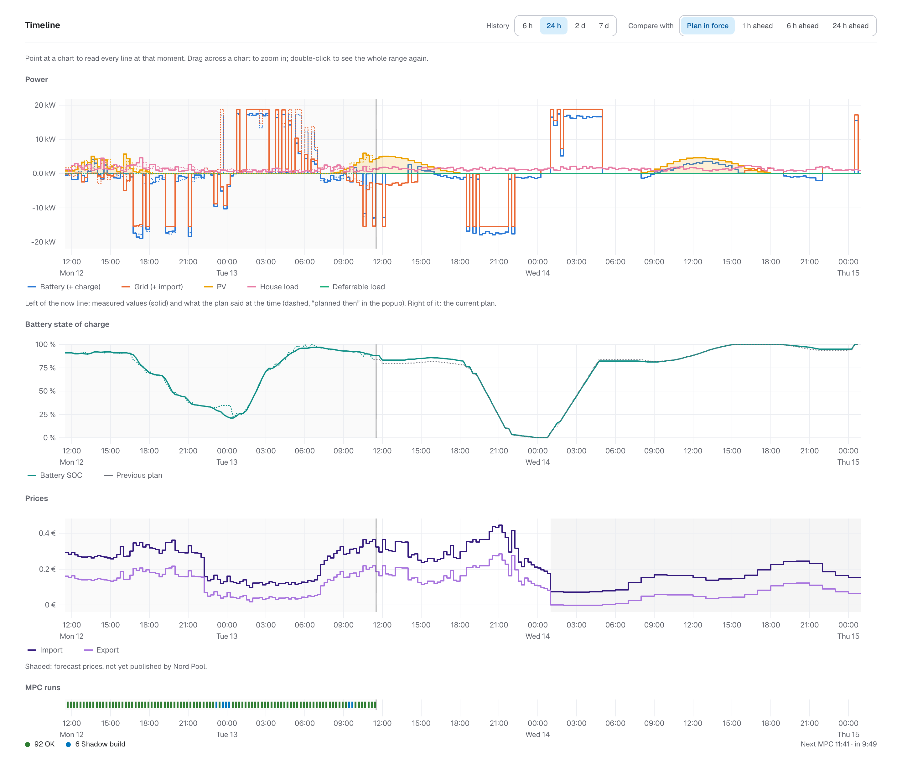
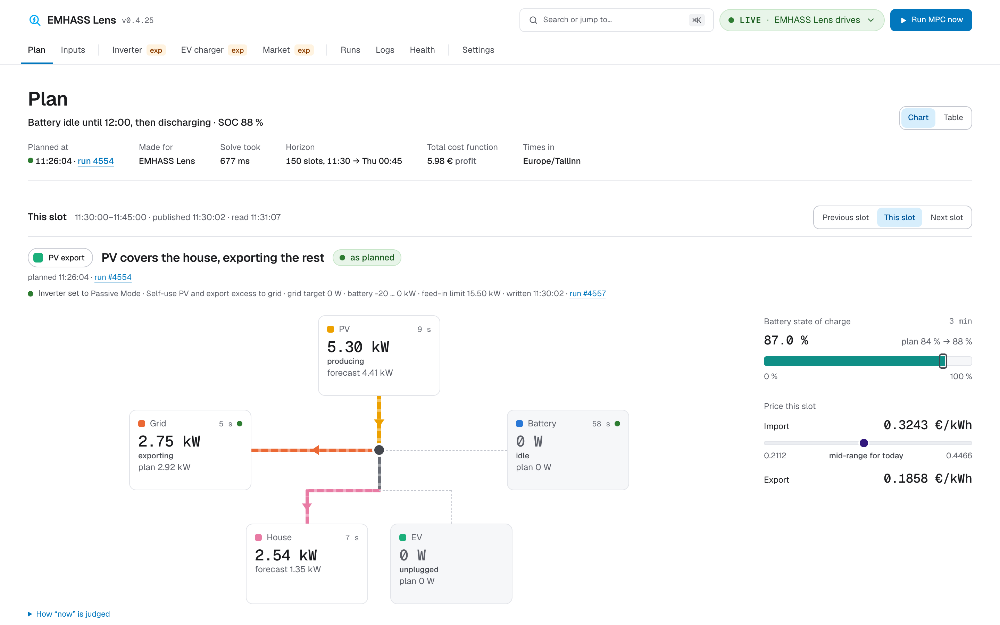
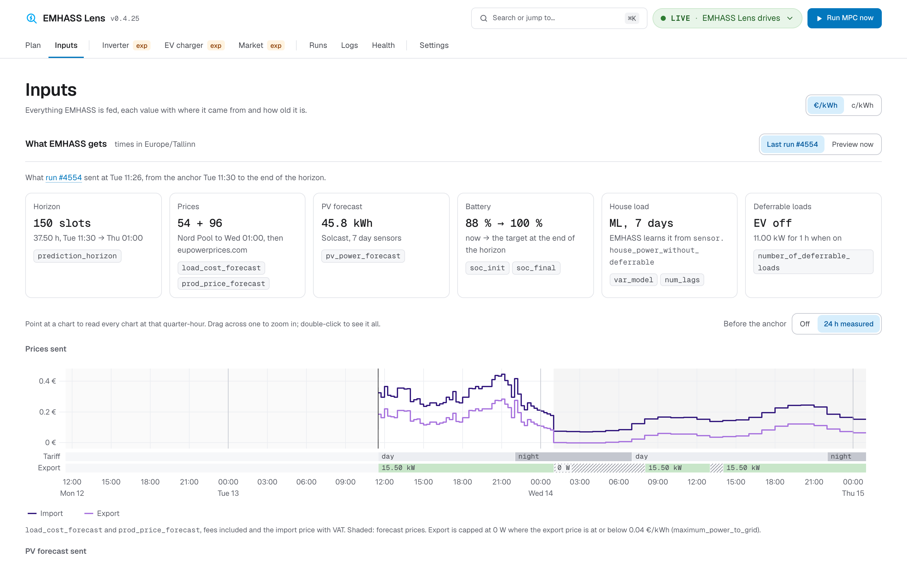
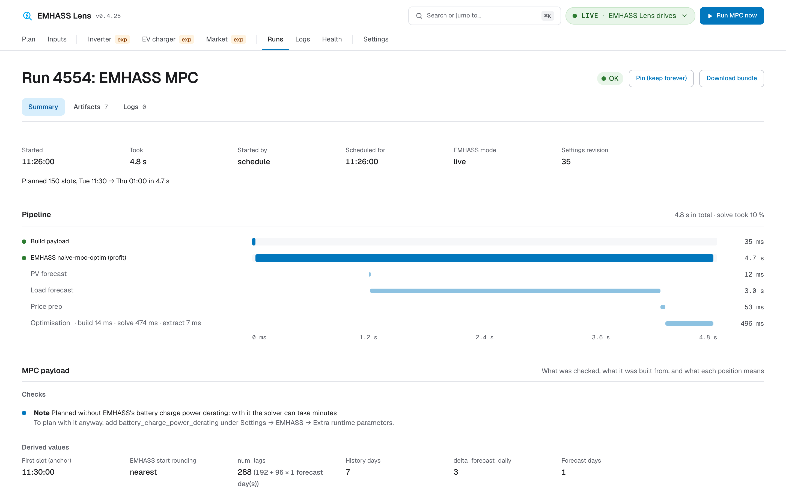
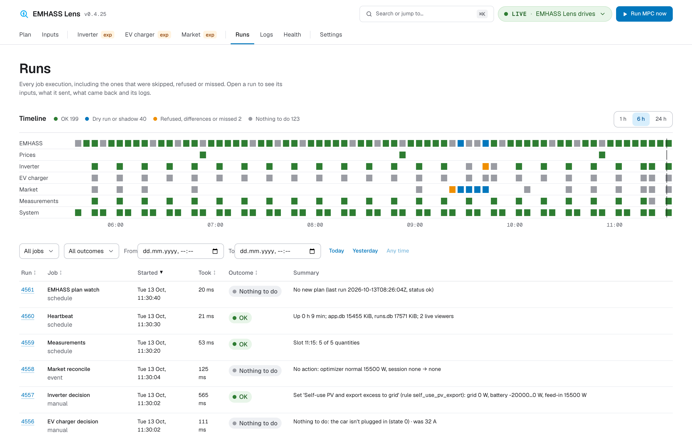

# EMHASS Lens

A Home Assistant App (add-on) that is the front end for [EMHASS](https://github.com/davidusb-geek/emhass).

- **Feeds EMHASS:** Nord Pool day-ahead prices with Estonian network tariffs, price forecasts for the days after (eupowerprices.com or nordpool-predict-fi), the Solcast PV forecast, battery SOC and deferrable loads.
- **Runs EMHASS:** MPC every quarter-hour, with the plan published as each slot starts.
- **Shows what EMHASS planned and why:** every run, every payload sent, every response and every log line, live in the Home Assistant sidebar.

It replaces the [homeassistant-ee-nordpool](https://github.com/anton4/homeassistant-ee-nordpool) HACS integration, which did the same through dozens of entities.

> **Status: experimental, in active development.**
> - Plan: [docs/PLAN.md](docs/PLAN.md).
> - Progress: [docs/STATUS.md](docs/STATUS.md).

## Screenshots

[](docs/screenshots/plan-timeline.png)

*The plan, next to what actually happened: power flows, battery state of charge and the import and export prices EMHASS planned against. Left of the now line is measured, right of it is planned.*

| | |
|---|---|
| [](docs/screenshots/plan.png)<br>**Now:** what this quarter-hour should do and what it is doing | [](docs/screenshots/inputs.png)<br>**Inputs:** every value EMHASS gets, with its source and age |
| [](docs/screenshots/run.png)<br>**A run:** its timings, checks, payload and EMHASS's response | [](docs/screenshots/runs.png)<br>**Runs:** every job, including the ones that were skipped or refused |

## Install as a Home Assistant App

1. **Settings → Apps → App store → ⋮ → Repositories**, add `https://github.com/anton4/emhass-lens`.
2. Install **EMHASS Lens** and start it.
3. Open it from the sidebar.

Everything else is configured in the App's own Settings page. The App's Configuration tab only has the log level and a safe mode switch.

## Standalone (development)

```sh
cp .env.example .env    # HA_URL + a long-lived access token
docker compose up --build
# http://localhost:8099
```

Or without Docker:

```sh
cd backend && uv sync && EMHASS_LENS_DATA_DIR=./data uv run python -m emhass_lens   # API on :8099
cd frontend && npm ci && npm run dev                                               # UI on :5173
```

## Repository layout

| Path | What |
|---|---|
| `emhass_lens/` | App metadata for the Supervisor (config.yaml, DOCS.md, CHANGELOG.md, translations) |
| `backend/` | Python 3.14 FastAPI service (uv project) |
| `frontend/` | React + Vite + TypeScript UI |
| `Dockerfile` | One image: built UI plus backend |
| `.github/workflows/` | CI, and the per-architecture image build pushed to ghcr.io |
| `scripts/make-local-addon.sh` | Build a local App folder that the Supervisor compiles itself |
| `scripts/readme_screenshots.py` | Retake the README screenshots from a running App |
| `docs/` | Plan and progress; `docs/screenshots/` holds the README images |

## Development

See [CLAUDE.md](CLAUDE.md) for the commands and the rules of the codebase.
